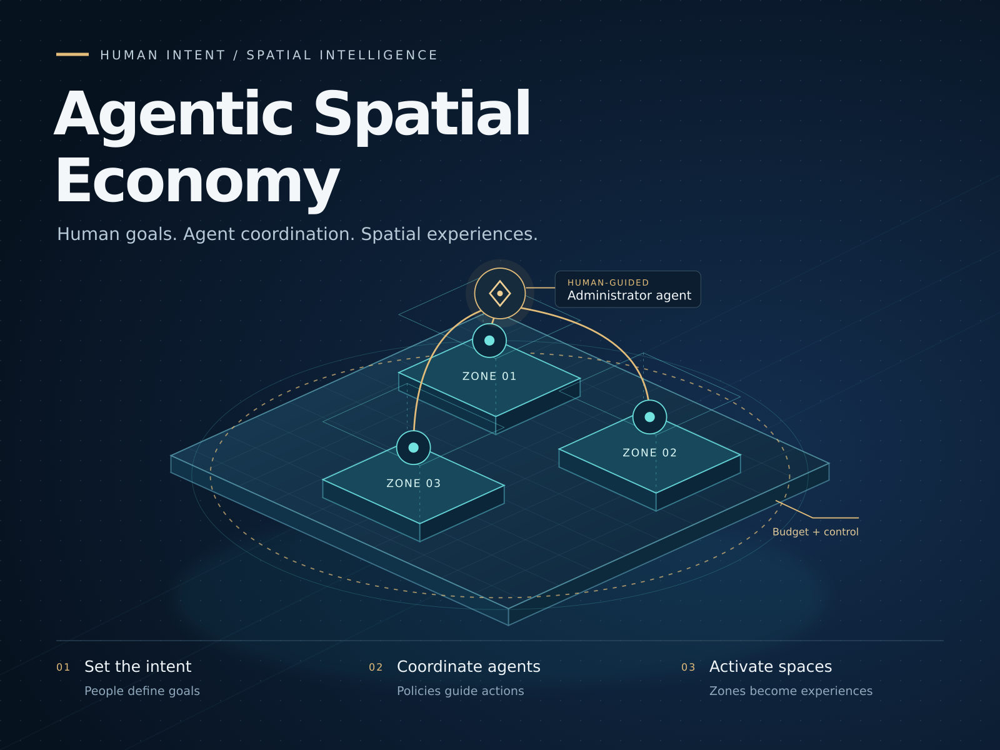

# Agentic Spatial Economy



**Your venue's AI operator, on a capped USDC budget.**

Agentic Spatial Economy explores how human administrators can delegate the operation of physical spaces to agents with explicit authority, spending limits and measurable objectives. Its first prototype recreates ONE16 in Lisbon as a mobile-first 3D event venue, with an in-world Stellar Passport demonstration and experimental native AR launch paths.

**[Open the public ONE16 demo](https://one16-lisbon-hackmeridian-3d.cabscryptocontacto.chatgpt.site)**

> This repository currently implements the spatial frontend—not a deployed autonomous economy. The agent, budget and payment architecture below is the intended next layer.

## Project docs

- [THESIS.md](THESIS.md) — who it is for, the problem, why Stellar. The source of truth.
- [SPEC.md](SPEC.md) — the HackMeridian MVP: demo path, ledger rules, done criteria.
- [DESIGN.md](DESIGN.md) — name, colors, type and screens.
- [AGENTS.md](AGENTS.md) — rules and tools for coding agents (Raven MCP, Stellar skills).
- [PLAN.md](PLAN.md) · [ISSUES.md](ISSUES.md) · [DEMO.md](DEMO.md) — schedule to submission, tasks, demo script.
- [agent/README.md](agent/README.md) — run the paid loop on Stellar testnet in about 5 minutes. The operator view is `dist/dashboard.html`.

## The idea

```text
Human administrator
  └─ objectives · budget · permitted spaces · content rights · approval rules
      └─ venue administrator agent
          ├─ sponsor / stand agent
          ├─ main-stage agent
          └─ other subspace agents
              └─ authorized services and paid API exchanges through x402
                  └─ mobile, 3D and AR experiences for visitors

Decisions, expenditure and outcomes → administrator dashboard
```

The person remains in control of the mandate. Agents would coordinate services and allocate approved resources; visitors would experience the results through familiar mobile interfaces, the venue's digital twin and AR—not only through an open camera.

x402 is proposed for paid service/API exchanges. It is not an agent identity system, a permission model or a replacement for budgeting and settlement controls. Not every agent interaction needs a payment.

The event is the initial use case. The longer-term opportunity is continuously operated spaces such as museums, universities and shopping centres, where subspaces have different operators, objectives and rights.

## What you can try today

1. Open ONE16 and select **Vive la experiencia**.
2. Explore the reconstructed entrance, yellow corridor, stairs, check-in, merchandise area, stands and main stage.
3. Use the overview and numbered review map to locate sections; return to the entrance without restarting the visit.
4. Open the **Stellar Passport** display from inside the venue to inspect the 3D asset and attempt its native AR launch on a compatible device.

**Desktop:** WASD / arrow keys and drag to look. **Mobile:** left-thumb virtual joystick and independent right-side touch look. Overview controls support inspection of the layout. The temporary numbered map supports spatial feedback and can be hidden.

The Passport interaction belongs inside the ONE16 experience. The standalone Passport page is a fallback, not the main journey. Its present placement near the activation totem is provisional, not a verified location of the real stand.

## Implementation status

| Layer | Current state |
| --- | --- |
| Venue viewer | Implemented: Three.js scene, walking, stair transitions, overview, reset, numbered map and mobile joystick. |
| Loading | Implemented: background preload, shared model loading, compressed-model transfer and fallback handling. |
| No-WebGL fallback | Static layout/imagery and an explicit fallback—not simulated 3D walking. |
| Passport | 3D asset and in-world inspection panel; Android/iOS native AR launch paths. |
| Physical AR | **Not yet verified on the target phone.** The user reported that the camera did not open. A native 3D viewer is not proof of AR. |
| AR anchoring | No image-marker recognition, venue georeferencing, persistent anchors or shared spatial registration. |
| Activation totem | Informational Stellar Testnet guide; no operational wallet connection, faucet claim or asset transfer. |
| Agents and economy | Planned: scoped agents, mandates, budget ledger, x402 service payments and administrator dashboard. No real payments are implemented. |
| Builder profiles | Planned: consent-based Stellar Passport/profile integration; no live profile synchronization. |

### Integrated source snapshot — 25 October 2026

- **This branch integrates** the published v19 exterior layout with the Android AR diagnostics previously prepared as v17. Exterior sections **2 and 3** and 34 orphaned railway/fence objects are removed; section **1**, the interior yellow stairs, umbrellas and remaining review IDs are retained.
- **Public demo remains v19**, source `8afc88f46c405d4d6e4bd12d271c5a7d6f8dc87b`, preserved on `release/site-v19`. This integration is a GitHub change, **not a Sites deployment**.
- Android's primary action requests **AR-only**; an explicitly labelled alternative may open 3D without a camera. Fallback and asset diagnostics are preserved. Physical-device AR remains unverified.
- The integrated checkout passes **83 automated tests**, plus real GLB parsing. Automated tests do not establish physical-device tracking or camera access.
- Source history and previous release branches are retained. No force push or production overwrite is required.

## Run locally

Requirements: Node.js with npm; Python 3 for the example static server. Three.js is pinned to **0.180.0**.

```bash
npm ci
node scripts/vendor.mjs
npm test
python3 -m http.server 8000 --directory dist
```

Open `http://localhost:8000`. The deployable static directory is **`dist/`**. There is no `npm run build` or `npm start` script in this prototype.

For mobile AR tests, use an HTTPS deployment opened directly in a compatible browser. A desktop localhost preview or embedded browser does not establish mobile AR compatibility. Native AR requires supported device software and an explicit user action; do not assume camera activation succeeded.

### Optional model regeneration

Blender is required to regenerate the venue; it is not required to view the committed assets.

```bash
blender -b --python model/build_venue.py
python3 scripts/prepare-model.py
node scripts/validate-glb.mjs dist/assets/one16.glb
npm test
```

The generation script writes into `dist/assets/`; transfer preparation updates the compressed asset and its loading metadata. Review generated changes before committing. The GLB validator uses the real Three.js loader.

## Repository guide

- `dist/` — static application, navigation, loading, review-map and AR-launch modules.
- `dist/assets/` — venue and Passport assets.
- `model/` — procedural Blender model source and venue sections.
- `scripts/` — dependency vendoring, model preparation and asset validation.
- `test/` — Node test suite for navigation, input, fallback, loading, overview and Passport flows.
- `docs/assets/` — project presentation artwork.

## Next proof points

1. **Verify the Passport demo on a physical Android/Chrome device:** launch camera-based AR, place the asset, exit and resume the venue without losing position. If unavailable, show an honest 3D fallback.
2. **Implement one bounded operational loop:** a human mandate → one venue agent → one subspace agent → one authorized service → a visible result.
3. **Add budget enforcement before real spending:** separate available, reserved and spent funds; enforce limits, approvals, idempotency and reconciliation. Start with clearly labelled test transactions.
4. **Demonstrate accountability:** distinguish agent actions, successful service calls, financial settlement and actual visitor interactions in the dashboard.
5. **Expand carefully:** sponsor experiences, host-controlled stage content and opt-in builder profiles. Advertising inventory must respect existing contracts and content rights.

Inputs such as event schedules, social content or camera-derived signals require an appropriate permission and privacy model. The demo does not currently implement autonomous monitoring or personal-data ingestion.

## Fidelity, attribution and rights

This is an interpretive reconstruction, not a measured architectural survey. Geometry, spacing and furniture placement include estimates; unobserved areas are not claimed to be accurate. Venue references include [ONE16](https://www.oneyourfirststop.com/eventos) and the [HackMeridian event](https://www.hackmeridian.com/).

This is an independent prototype. Use of Stellar, Stellar Passport, HackMeridian and venue names or visual references does **not** imply official sponsorship, endorsement or affiliation. “Sponsor” describes a proposed experience category, not a confirmed commercial relationship.

Third-party names, artwork and assets retain their respective rights. Three.js includes its license in `dist/vendor/three/LICENSE` after vendoring. Public source availability does not itself grant a blanket license to project code or third-party assets; check applicable licenses and obtain permission before reuse. Raw reference recordings, personal information and credentials do not belong in public commits.
